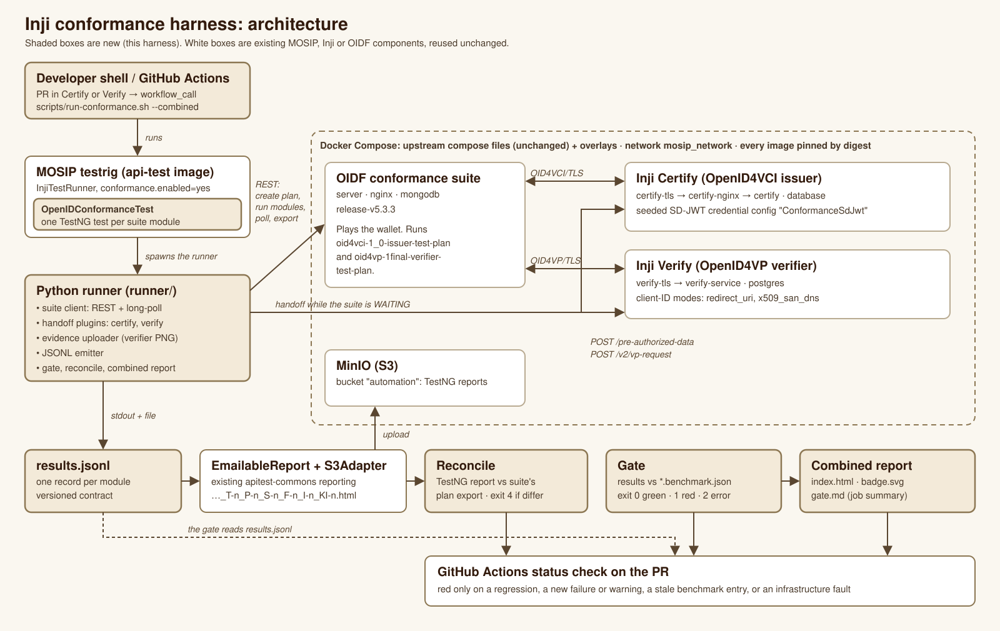

# Architecture

## Overview



The same flow in text, with every call:

```
 developer shell / GitHub Actions
      │  scripts/run-conformance.sh --component certify|verify | --combined
      ▼
 scripts/env.sh up ──► docker compose: upstream compose files (unchanged) + compose/*.yml overlays
      │                 project oidf     server, nginx, mongodb                  (OIDF suite)
      │                 project certify  database, certify, certify-nginx, certify-tls
      │                 project verify   postgres, verify-service, verify-tls
      │                 all reachable on the external network mosip_network
      │  wait-ready.sh, then seed-certify.sh (SD-JWT credential configuration)
      ▼
 for each plan config  plans/<component>/<config>.json
      │
      │   ┌─ testrig path ────────────────────────────────────────────────────┐
      │   │ api-test jar, conformance.enabled=yes                            │
      │   │   InjiTestRunner ─► injicertify|injiverifyConformanceSuite.xml   │
      │   │   OpenIDConformanceTest ─ spawns ─► python3 -m runner run …      │
      │   └──────────────────────────────────────────────────────────────────┘
      ▼
 runner (python -m runner run)
      │  REST: create plan, create/start module, poll state, read log, upload image, export
      ├──────────────────────────────────────► OIDF suite ◄── HTTPS ──► certify-tls ─► certify-nginx ─► certify
      │                                         (WAITING)               verify-tls  ─► verify-service
      │  handoff plugins, when a module is WAITING:
      │    certify: POST $CERTIFY_API/pre-authorized-data ─► GET <suite credential_offer_endpoint>?<query of the returned credential_offer_uri>
      │             (tx_code step: GET <suite tx_code_endpoint>?code=…)
      │    verify:  POST $VERIFY_API/v2/vp-request ─► GET <suite authorization_endpoint>?client_id=…&request_uri=…
      │    evidence (verify): GET $VERIFY_API/vp-result/{txn} ─► PNG ─► POST suite image placeholder
      ▼
 results.jsonl  (stdout + <out>/results.jsonl; contract in docs/results-contract.md)
      │
      ├─► OpenIDConformanceTest: one TestNG test per module, named OIDF_<component>_<module>
      │       └─► EmailableReport (unchanged) …-full-report_T-n_P-n_S-n_F-n_I-n_KI-n.html
      │               └─► S3Adapter (unchanged) ─► MinIO, bucket = s3-account, key <module>/<report file>
      │
      └─► python -m runner gate results.jsonl plans/<component>/<config>.benchmark.json
              ├─► gate.md + exit 0 green / 1 red / 2 cannot evaluate
              ├─► python -m runner combined ─► combined/index.html, badge.json, badge.svg, gate.md
              └─► python -m runner diff A.jsonl B.jsonl (CI: against the last successful run)

 testrig driver, after each gate:
      python -m runner reconcile <config>/testng-report  ─► TestNG rows vs the suite's own plan export zip
              └─► reconcile.md + exit 0 match / 1 mismatch (run exits 4) / 2 cannot evaluate
```

`scripts/run-conformance.sh` runs each config through the testrig path by default: it builds the patched api-test image, starts MinIO, and runs the image in conformance mode, so `OpenIDConformanceTest` starts the runner and `EmailableReport` and `S3Adapter` do the reporting. With `CONFORMANCE_DRIVER=runner` it calls the runner directly. Either way the gate reads the same `results.jsonl`, and the two drivers give identical results (`evidence/sp4/SP4.14/parity-*.md`). The manual testrig recipe is in [usage.md](usage.md#testrig-integration).

## Components

### Compose environment (`compose/`, `scripts/env.sh`)
- **Upstream files are never edited.** `env.sh` combines each upstream compose file with one overlay: `upstream/conformance-suite/docker-compose-prebuilt.yml` with `compose/suite.yml`, `upstream/inji-certify/docker-compose/docker-compose-injistack/docker-compose.yaml` with `compose/certify.yml`, and `upstream/inji-verify/docker-compose/docker-compose.yml` with `compose/verify.yml`. `scripts/fetch-upstream.sh` clones the three repos at the commits in `compose/.env.pinned` if they are missing, and refuses to run if an existing clone is at a different commit.
- **Pins.** Every image is referenced as `repo:tag@sha256:…` from `compose/.env.pinned`; the digest is the pin ([ADR-006](design-decisions.md#adr-006-pin-every-image-by-digest)).
- **TLS fronts.** The suite requires `https://` for the credential offer and the issuer metadata, and accepts any certificate. Two nginx containers, `certify-tls` and `verify-tls`, terminate TLS with a self-signed certificate from `scripts/gen-certs.sh`. Certify is configured as its own authorization server, advertised at `https://certify-tls`, so `credential_issuer` equals the URL the suite uses. The `certify-tls` template is selected by `CONFORMANCE_CERTIFY_AS_METADATA_SHIM`: `compose/tls/proxy-shim-false.conf.template` passes the metadata through, while `proxy-shim-true.conf.template` injects a placeholder `authorization_endpoint`. Both templates include `/etc/nginx/extra.d/*.conf`, where fault and version snippets are mounted.
- **Services not started.** `mimoto-service` and `inji-web` (profile `inji-wallet`) and `verify-ui` (profile `ui`) are moved to compose profiles: the suite plays the wallet and talks to the components directly. `docker compose --profile <name>` brings them back.
- **Other overlay changes.** Verify's database is initialised from the upstream DDL (`compose/verify-db/10-verify-ddl.sh`), because the compose `init.sql` is stale and makes `direct_post` fail with HTTP 500. Verify's Postgres publishes no host port. `verify-service` joins `mosip_network`. Verify signs with a test leaf certificate (`CN=test.example.com`) issued by a test CA. Health checks gate `--wait`.
- **Readiness.** `scripts/wait-ready.sh` checks the suite API, Certify's issuer and AS metadata as seen from inside the suite container (including `credential_issuer == https://certify-tls`), and Verify's health from the host and from the suite. `scripts/seed-certify.sh` creates the `ConformanceSdJwt` credential configuration (`compose/seed/certify-sdjwt-config.json`) if it is missing. Certify's database lives in an anonymous volume, so the configuration is lost on `down`.

Endpoints:

| What | From the host | From the suite (on `mosip_network`) |
|---|---|---|
| OIDF suite | `https://localhost.emobix.co.uk:8443` | — |
| Certify API | `http://localhost:8091/v1/certify` | `https://certify-tls` (issuer id) |
| Certify TLS front | `https://localhost:9443` | `https://certify-tls` |
| Verify API | `http://localhost:8080/v1/verify` | `https://verify-tls/v1/verify` |
| MinIO (optional) | `http://127.0.0.1:9000` (console `:9001`) | — |

### Runner (`runner/`)
A Python package that drives the suite through its REST API. It uses the suite's own `conformance.py` client, vendored unmodified under `runner/_vendor/` (MIT). It doesn't use `run-test-plan.py`, because that script hard-codes the per-test-family handling of the `WAITING` state, which is exactly where the handoff plugins need to act, and it can't be imported. Runtime dependencies are `httpx` and `pillow`, pinned to the versions Ubuntu 24.04 ships, so the same code runs on the testrig image's system Python.

`python -m runner run <template> --out DIR`:
1. **Load the template** (`templates.py`): resolve `${VAR}` placeholders from the environment.
2. **Prepare** (`setup.py`). For Certify, it reads the AS metadata through the TLS front and records whether `authorization_endpoint` is present. That is the *observed* shim flag; if it differs from the template's `expect.certify_as_metadata_shim`, the run aborts with exit 2. It then seeds the credential configuration if `GET /credential-configurations/<id>` is not 200. For Verify, it checks the evidence mode.
3. **Create the plan** with a unique alias `<component>-<run_id>`. A duplicate alias would stop a running test, so parallel runs never collide.
4. **Run each module in turn**: create it, start it, and wait. Whenever the module is `WAITING`, read what the suite exposes (offer endpoint, authorization endpoint, image placeholders) and call the plugin (`handoff.py`) and, for Verify, the evidence uploader (`runner/evidence.py`). Then wait again. Any exception or the per-module timeout becomes an `infra` record, and the module is stopped.
5. **Write** each module's suite log (`<module>.log.json`), the plan's HTML export (zip), and the `end` record.

The runner never decides pass or fail for the build. It maps suite outcomes ([ADR-003](design-decisions.md#adr-003-mapping-suite-outcomes-to-testng-results)), and the gate decides.

Step by step, with the REST calls and the long-poll: [how-the-api-automation-works.md](how-the-api-automation-works.md).

### Handoff plugins (`runner/handoff.py`)

Per-component detail, with observed log lines: [handoff.md](handoff.md).

- **certify.** When the suite exposes `credential_offer_endpoint`, the plugin calls Certify's `POST /pre-authorized-data` with the template's `handoff.offer` (credential configuration id, claims, `expires_in`, `tx_code`). It then calls the suite's offer endpoint with the query string of the returned `credential_offer_uri`, as a wallet would receive it. When the suite exposes `tx_code_endpoint`, the plugin sends the transaction code there.
- **verify.** When the suite exposes `authorization_endpoint`, the plugin calls Verify's `POST /v1/verify/v2/vp-request` with the template's `handoff.vp_request` (client id and DCQL query), and then opens the suite's authorization endpoint with the same parameters Verify's own SDK builds: `client_id` plus `request_uri`, or the inline `response_mode`, `nonce`, `response_uri`, `state` and `dcql_query`. It does this once per module.
- **evidence (verify).** When a module has an empty image placeholder, the uploader fetches `GET /v1/verify/vp-result/{transactionId}`, saves it as `<module>.verify-result.json`, renders it to `<module>.verify-result.png` and uploads the PNG. The suite then marks the module `REVIEW`.

### TestNG bridge (`testrig-bridge/`)
A patch for each api-test module: one class (`…testscripts.OpenIDConformanceTest`, implementing `org.testng.ITest` like the existing scripts), one suite XML (`testNgXmlFiles/inji{certify,verify}ConformanceSuite.xml`), one `conformance.*` properties section, a small hook in `InjiTestRunner`, and one Dockerfile line (`python3 python3-httpx python3-pil`). With `conformance.enabled=yes`, `InjiTestRunner` skips the platform setup (Keycloak users, eSignet, master data, none of which exist in the compose stack) and runs only the conformance suite XML. Otherwise nothing changes, because the new XML doesn't match `mastertestsuite`.

The data provider is lazy. It starts the runner, reads stdout line by line and yields one test per `module` record as it arrives. When the stream ends early, it adds an `INFRA:` failure for every module listed in the plan record that has no result. Each test is named `OIDF_<component>_<module>`, and its description carries the config name and the observed flags (`certify_as_metadata_shim=false`, or `not observed` on an aborted run). Mapping: `pass` → pass; `warning` → pass, or fail when `conformance.strict=yes`; `review` and `skip` → skip; `fail` → fail with the first failed condition and the suite log URL, or a KI skip when the test name is in `testCaseSkippedList.txt`; `infra` → fail, never KI.

Reporting is entirely the testrig's own. `EmailableReport` names the file with its T/P/S/F/I/KI counts, and `S3Adapter` uploads it when `push-reports-to-s3=yes`. No new reporter.

### Gate, diff and combined report (`runner/gate.py`, `runner/combined.py`)
- **Benchmark** (`plans/<component>/<config>.benchmark.json`, [ADR-004](design-decisions.md#adr-004-conformance-benchmark-gate)). For each module it records the expected outcome, the first failing condition (for FAILED), the sorted set of expected warning conditions, a finding id, a KI id and a human-written reason. A `variant_key` (plan, variant and observed flags) ties the file to one configuration, so a shim-on run can never be gated against the shim-off benchmark.
- **Gate verdicts.** `OK`, `NOT_RUN` (in the benchmark but not in this run's `--modules` selection), `STALE` (better than expected, or an expected warning disappeared), `REGRESSION` (worse), `NEW_FAILURE` (still FAILED, at a different condition), `NEW_WARNING`, `UNBENCHMARKED`, `STRICT_WARNING`, `INFRA`. Any verdict other than `OK` or `NOT_RUN` makes the gate red.
- **Diff.** Compares two runs module by module (outcome and first failing condition) and prints a Markdown table. CI diffs each config against the last successful run on the default branch.
- **Combined.** Gates several runs together and writes one HTML page, `badge.json` (shields.io endpoint format), `badge.svg` (the same badge, rendered; CI pushes it to the `badges` branch for the README) and the concatenated `gate.md`.

### Reconciliation (`runner/reconcile.py`)
The gate trusts `results.jsonl`, which is the harness's own output. The reconcile check closes that loop against the suite: after every testrig run, it compares each module's TestNG status with the status and result in the suite's plan export, mapped through the same ADR-003 table. It also compares the EmailableReport's T/P/S/F/KI counts with the suite. A disagreement makes `scripts/run-conformance.sh` exit 4, so CI fails. Evidence: MATCH on all 34 modules of a live combined run (`evidence/sp5/SP5.2/live/*/reconcile.md`), and MISMATCH on doctored reports (`evidence/sp5/SP5.2/doctored/`).

### CI (`.github/workflows/full-stack-conformance.yml`)
Runs on `workflow_dispatch` (inputs `strict`, `parallel`, `fault`, `certify_shim`) and on tags `v*` and `release-*`. A matrix of `certify`, `verify` and `combined` sets up JDK 21 (`actions/setup-java`) and runs `scripts/run-conformance.sh` with the default testrig driver on `ubuntu-24.04`. Each job writes the run info, gate and reconcile tables and timing to the job summary, diffs against the previous successful run, and uploads `reports/` as the artifact `conformance-<target>`.

## Data flow, one Verify module

1. The runner creates `oid4vp-1final-verifier-happy-flow` and starts it. The suite goes to `WAITING` and exposes its `authorization_endpoint`.
2. The verify plugin calls `POST http://localhost:8080/v1/verify/v2/vp-request` with the DCQL query. Verify returns a `transactionId` and `requestUri` (or inline authorization details).
3. The plugin opens the suite's authorization endpoint with `client_id` and `request_uri`. The suite, acting as the wallet, fetches the request from `https://verify-tls/…`, builds an SD-JWT presentation and posts it to Verify's `response_uri` (`direct_post`).
4. The suite creates an image placeholder and waits. The runner fetches `GET /v1/verify/vp-result/{txn}`, renders it and uploads the PNG. The module finishes as `REVIEW`, or as `FAILED` if a condition failed earlier.
5. The runner reads the module's info and log and emits one `module` record. The bridge turns it into the TestNG test `OIDF_verify_oid4vp-1final-verifier-happy-flow`. The gate compares it with the benchmark entry.

## Where the outputs land

| Output | Path |
|---|---|
| Runner, per config | `<out>/results.jsonl`, `<out>/<module>.log.json`, `<out>/*.verify-result.{json,png}`, `<out>/plan-config.json`, plan export `<out>/<plan>-….zip` |
| Entry script | `reports/run-info.txt`, `reports/timing.tsv`, `reports/<config>/{results.jsonl,stdout.jsonl,stderr.log,gate.md,gate.exit,reconcile.md,reconcile.exit}`, `reports/<config>/{benchmark-update.md,benchmark.proposed.json}` (red gate), `reports/combined/{index.html,badge.json,badge.svg,gate.md}` |
| Testrig (in the container) | `/home/inji/testng-report/*-full-report_T-…html`; the runner output under `/home/inji/testng-report/conformance/<config>/` |
| MinIO | bucket `s3-account` (default `automation`), key `<modules>/<report file>` |
